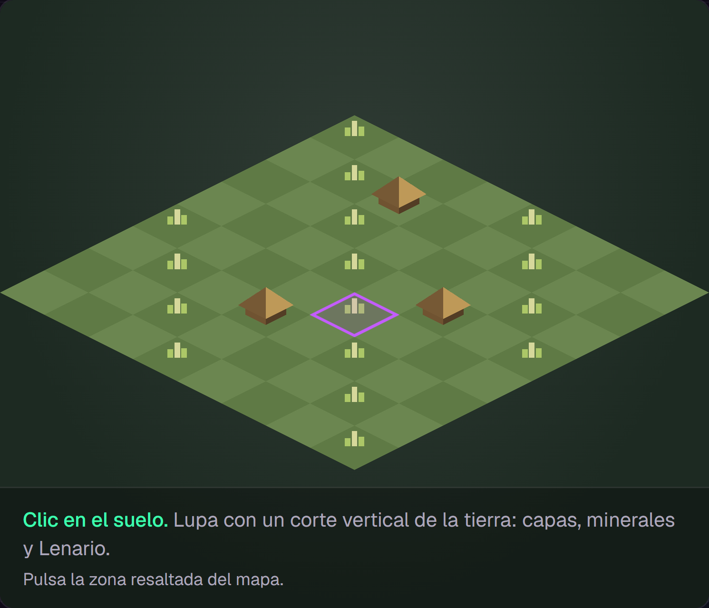
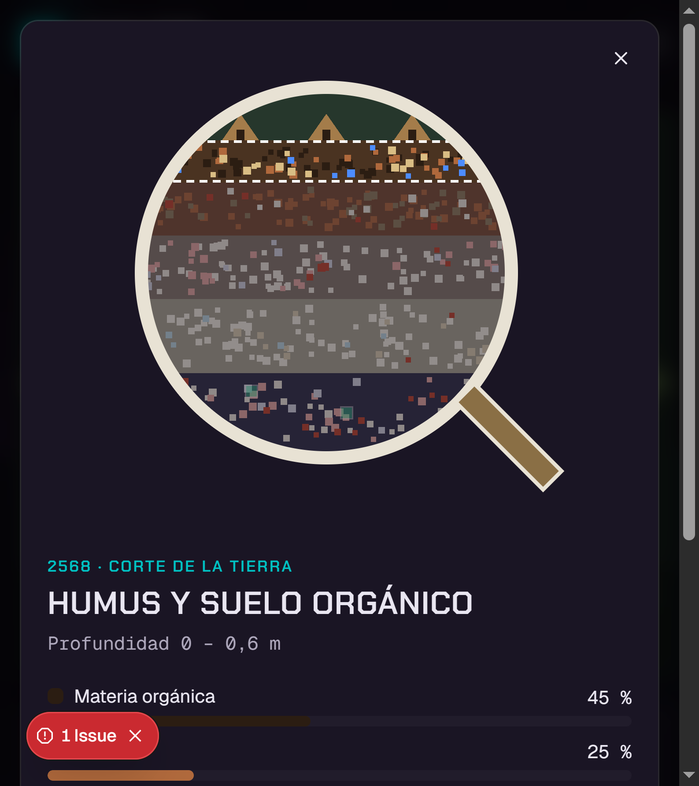
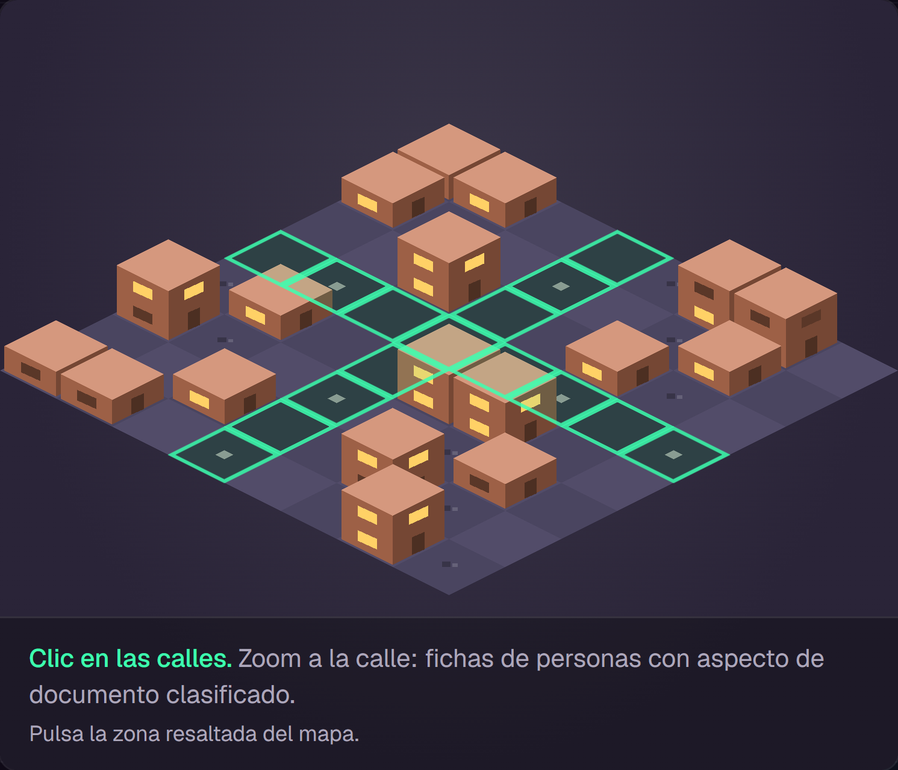
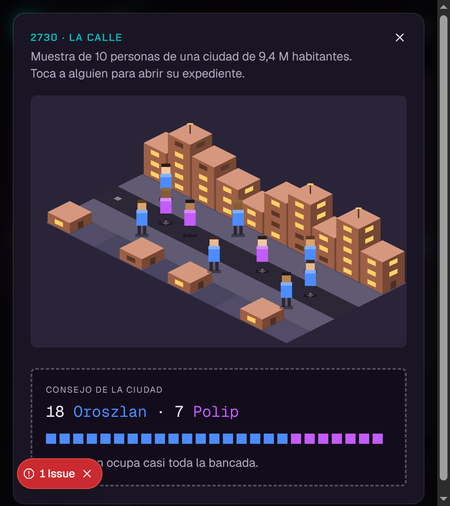
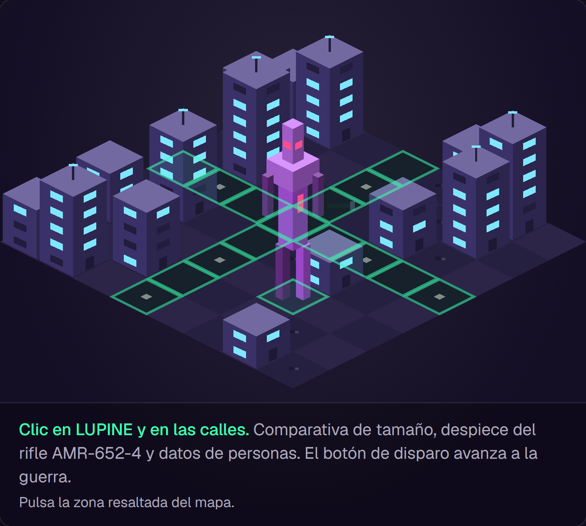
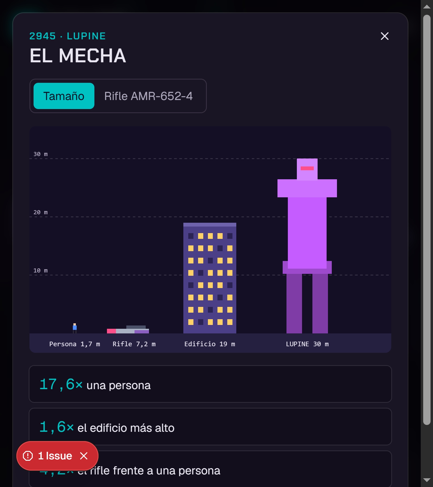
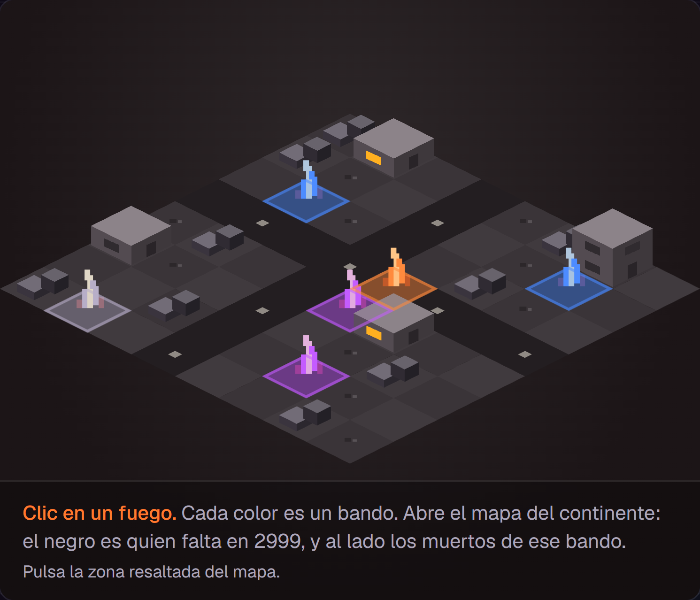
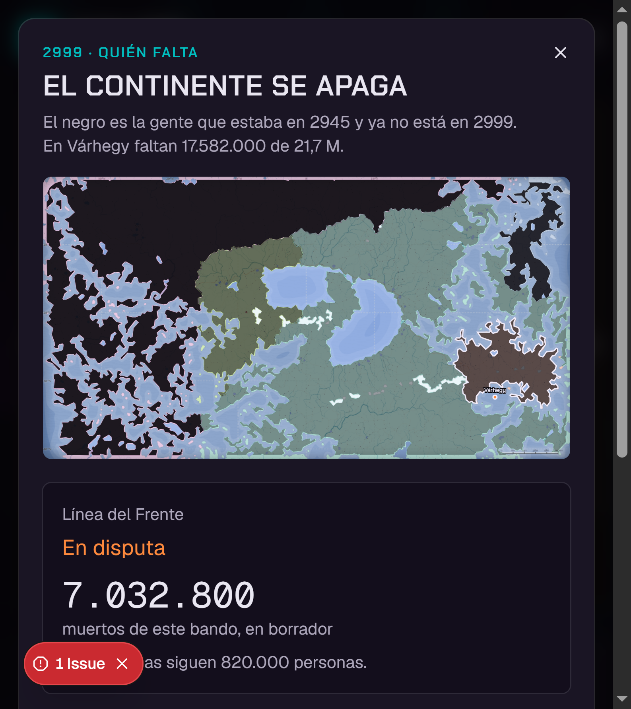
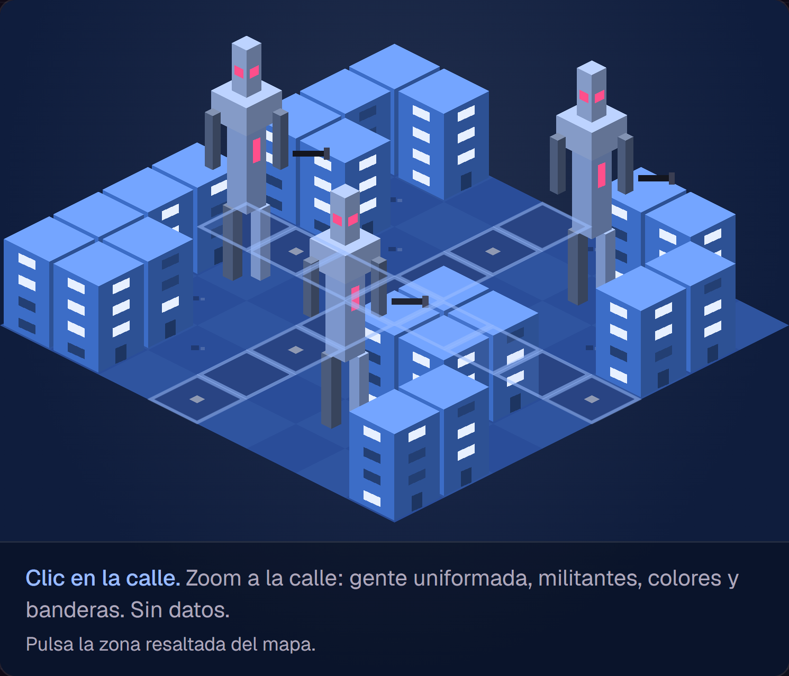
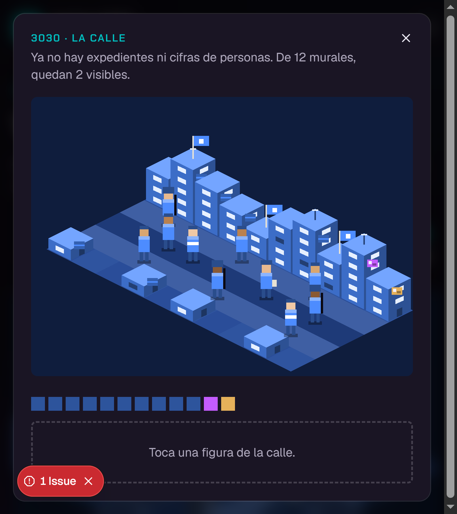

# Bitácora de Várhegy

Estado al 11 de noviembre de 2026. La spec de la ciudad sigue en `docs/spec-varhegy.md`. Las casillas de la calle tienen la suya en `docs/spec-casillas-calle.md`. Esta bitácora cuenta qué se decidió en cada etapa y cómo se ve ahora.

Las capturas son de la primera versión publicada, tomadas en `http://127.0.0.1:43127/varhegy/`. Muestran los sprites y las ventanas de entonces. No incluyen las casillas, la escala en millones ni los textos nuevos. En algunas ventanas aparece una pastilla roja que dice «1 Issue»: es del navegador de prueba, no de la página.

Los números marcados como borrador se editan en los CSV de `src/data/csv/`. La web los lee al arrancar.

## 1. La ciudad, no el mundo

El mapa protagonista es Várhegy, capital de Karpatenland, contada en cinco momentos. Es una ciudad de oposición (Polip) al régimen Oroszlan de 3030. Los datos del país y del continente son contexto.

Cinco momentos: 2568 prehistoria, 2730 primera civilización, 2945 incertidumbre, 2999 guerra, 3030 posguerra.

## 2. Los números

Los tres CSV originales del censo no se tocaron. Los de la ciudad son borrador.

Regla para que cuadren con el censo:

- En 2730 el país de Várhegy tiene 85 millones. El 70,1 % simpatiza con Oroszlan y el 29,9 % con Polip.
- En los otros años el país es el 10,95 % de Karpatenland.
- La ciudad es un porcentaje del país: 11 % en 2730, 15 % en 2945, 8 % en 2999, 10 % en 3030. En 2568 es una aldea de 18.000 personas.

## 3. El armazón

Una línea de tiempo de cinco marcas, la maqueta isométrica y un texto fijo por momento. La maqueta no se encoge cuando se abre un dato: lupa, calle, rifle y mapa del continente salen en una ventana encima.

## 4. 2568 · el suelo

Tierras baldías, tres chozas y matas de pasto. Clic en el suelo: una lupa con el corte de cinco capas. El Lenario está en el lecho cristalino.

Datos: `varhegy-estratos-2568.csv`.

## 5. 2730 · la calle y el consejo

Ciudad baja, ventanas cálidas. Clic en la calle: diez personas y un expediente con aspecto de documento clasificado.

Antes de elegir a alguien se ve el consejo de la ciudad: 18 escaños de Oroszlan y 7 de Polip. Es el gobierno local. No repite el 70,1 % del censo del país.

Datos: `varhegy-habitantes.csv` y `varhegy-vida-urbana.csv`.

## 6. 2945 · la calle, el mecha y el rifle

Edificios altos, ventanas cian y un LUPINE en la plaza. Hay dos zonas tocables.

La calle repite el expediente y suma horas, medicinas y la torta mecánico / natural. El consejo queda 13 a 12. La ciudad, en conjunto, trabaja 61 h por semana y la ración es de 2 al día. Esas dos cifras acompañan cada ficha.

LUPINE abre la comparativa de tamaño (persona 1,7 m, rifle 7,2 m, edificio 19 m, mecha 30 m) y el despiece del rifle AMR-652-4. El botón Disparar cierra la ventana y pasa a 2999.

La altura del mecha es borrador en `varhegy-escala.csv`. Las piezas del rifle están en `src/data/varhegy-rifle.ts`.

## 7. Los sprites

Un solo kit, reteñido por momento: edificio con ventanas y antena, choza, escombros, fuego, LUPINE, pasto o piedras, y marcas de calle. Vive en `src/components/varhegy/sprites.tsx`. Se ve en las capturas de cada año.

## 8. 2999 · la guerra

Seis fuegos, uno por zona. El color es el bando: azul régimen, morado oposición, naranja frente, gris campamentos.

Al tocar un fuego se abre el mapa del continente, el mismo de la visualización de población. El negro es quien estaba en 2945 y ya no está en 2999. Al lado, los muertos de ese bando. Esos muertos son borrador y suman los 17.582.000 que faltan en la ciudad. El censo no cuenta muertos: cuenta quién falta.

Datos: `varhegy-bajas-2999.csv`. El número de cada fila es el total del bando, no de una sola zona.

| Región | Falta en 2999 |
|---|---|
| Nagy-Alföld | 38 % |
| Dunántúl | 54 % |
| Karpatenland | 65 % |
| Alpenvorland | 83 % |
| Ostseeküste | 89 % |

## 9. 3030 · un solo azul

La ciudad es azul Oroszlan. Hay varios LUPINE, banderas y gente uniformada, sin expedientes.

En la calle, de 12 murales quedan 2 visibles. El resto está tapado de azul.

Datos: la fila 3030 de `varhegy-vida-urbana.csv`.

## 10. La escala en el suelo

Las losas anidadas ya estaban en la calle. Lo que faltaba era que se leyera la magnitud.

Primero se probó solo «de cada 100» (1,6 / 11 / 100). No se quedó: se perdían los cientos de millones. La lectura actual muestra las dos cosas. En 2945: Karpatenland 1.319 millones (100), país 145 millones (11), ciudad 21,7 millones (1,6). En 2730 la región es 776 millones y la ciudad 1,2.

En las casillas, las etiquetas dibujadas dentro del mapa quedaban cortadas por el recorte. Por eso, cuando la calle está partida, la cifra va debajo del dibujo, sobre el mismo cielo. En la calle entera (3030) las etiquetas siguen dentro del dibujo.

## 11. Los textos

Mari reescribió la cabecera y los momentos. Se dejó la ortografía tal como la escribió, incluida «Váhergy» en 2730.

«Capital de Karpatenland» pasó a la derecha del título. Misma letra y mismo tamaño; solo cambió el lugar.

El párrafo de entrada es: «La historia de nuestra civilización esta escrita en los suelos de Várhegy, permiteme enseñarte a leerla. -El biólogo».

Títulos y textos que quedaron: 2568 «Las primeras raíces», 2730 «Nuestra capital», 2945 «La noche se acerca» (el título ya estaba; cambió el cierre, de LUPINE como amenaza a la figura que mira con frialdad), 3030 «Un solo color» con el cierre del mar de plata sin voz. El texto de 2999 no se tocó.

Se quitaron las instrucciones que había debajo del mapa («Clic en el suelo…», «Pulsa la zona…»). El nombre de cada zona, para quien usa teclado, se quedó corto: solo el nombre del lugar.

## 12. La calle en cinco casillas

2730 es la base aprobada. La calle se parte en cinco tramos, de izquierda a derecha. Cada tramo son dos columnas y dos de las diez personas. Dentro de la ventana se pasa de casilla con Anterior, Siguiente o las flechas. Cada baldosa «=» del mapa abre su tramo, no la calle entera.

2945 usa el mismo corte. El LUPINE del mapa no entra en esa calle: sigue abriendo el tamaño y el rifle. 2568 no cambió.

Se probó meter el robot a 30 m dentro de una casilla. A esa escala (una persona mide 1,7 m) llenaba la ventana y la calle desaparecía. Se deshizo. 3030 volvió a la calle completa, sin casillas y sin robot en la acera.

Queda escrito y sin construir, en `docs/spec-casillas-calle.md`:

- Paso 2: una silueta solo en la casilla 5 de 2730, unas tres veces una persona, con la gente entera a sus pies. Los 30 m siguen en la comparativa de 2945.
- Paso 3: 3030 también en cinco casillas, un robot en cada una a ese tamaño, el civil en la esquina opuesta.

## 13. Cómo se avanza de año

En 2945, Siguiente no avanza. Abre una ventana con el texto exacto: «El inicio del fin esta marcado por los frios pasos de Lupine». La flecha derecha hace lo mismo. La única puerta a 2999 es el botón Disparar del rifle.

Mientras el año en pantalla es anterior a 2999, las marcas 2999 y 3030 de la línea de tiempo no se pueden pulsar. Desde 2999, Siguiente sí lleva a 3030. En 3030 ese botón no existe: es el último momento. Anterior sigue funcionando.

## 14. El despiece del rifle

El dibujo generado, con piezas separadas y un control de porcentaje, no se quedó. Tampoco el recorte del dibujo a mano como imagen fija: el archivo sigue en `public/referencias/rifle-amr-652-4-despiece.jpg`, pero ya no se muestra.

Lo que se ve es el video de Mari, `public/referencias/rifle-amr-652-4-despiece.mp4`. Los nombres de las piezas y sus textos siguen al lado. Disparar sigue pasando a 2999.

Los números marcados como borrador se dejaron como estaban: altura del mecha, muertos de la guerra, vida urbana, frases de los roles en 3030 y las descripciones de las piezas. El texto de la reserva de plasma es de Mari.

## 15. Várhegy es la única entrada

La portada del sitio es ahora esta historia. El encabezado ya no muestra Archivo, Mundo ni Fuentes, y el pie ya no enlaza al censo. La marca «Archivo 3030» sigue arriba y lleva a la misma página.

No se borró el resto. La portada anterior está guardada en `src/components/archivo-home.tsx`, sin enlace. Mundo, los gráficos, las fuentes y los CSV siguen en el proyecto. Si se escribe a mano `/mundo`, `/datos` o `/graficos/mapa`, esas páginas todavía se abren.

## 16. Qué falta

- La silueta de la casilla 5 en 2730 y los robots de 3030. Están en la spec; no se construyen hasta verlos paso a paso.
- Sonido y revisión en móvil.
- Cerrar también las direcciones escritas a mano, si se quiere que Mundo y el archivo no se puedan abrir ni así.

## Dónde está cada cosa

| Qué | Dónde |
|---|---|
| Escenas, textos y colores | `src/data/varhegy.ts` |
| Maqueta | `src/components/varhegy/iso-stage.tsx` |
| Calle y casillas | `src/components/varhegy/street-zoom.tsx` |
| Escala en el suelo | `src/components/varhegy/ground-scale.tsx` |
| Video del rifle | `public/referencias/rifle-amr-652-4-despiece.mp4` |
| Spec de las casillas | `docs/spec-casillas-calle.md` |
| Portada anterior, sin enlace | `src/components/archivo-home.tsx` |
| Sprites | `src/components/varhegy/sprites.tsx` |
| CSV editables | `src/data/csv/varhegy-*.csv` |
